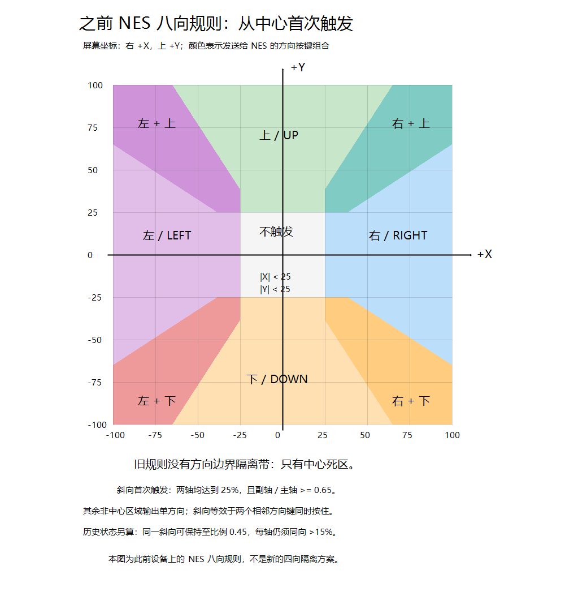
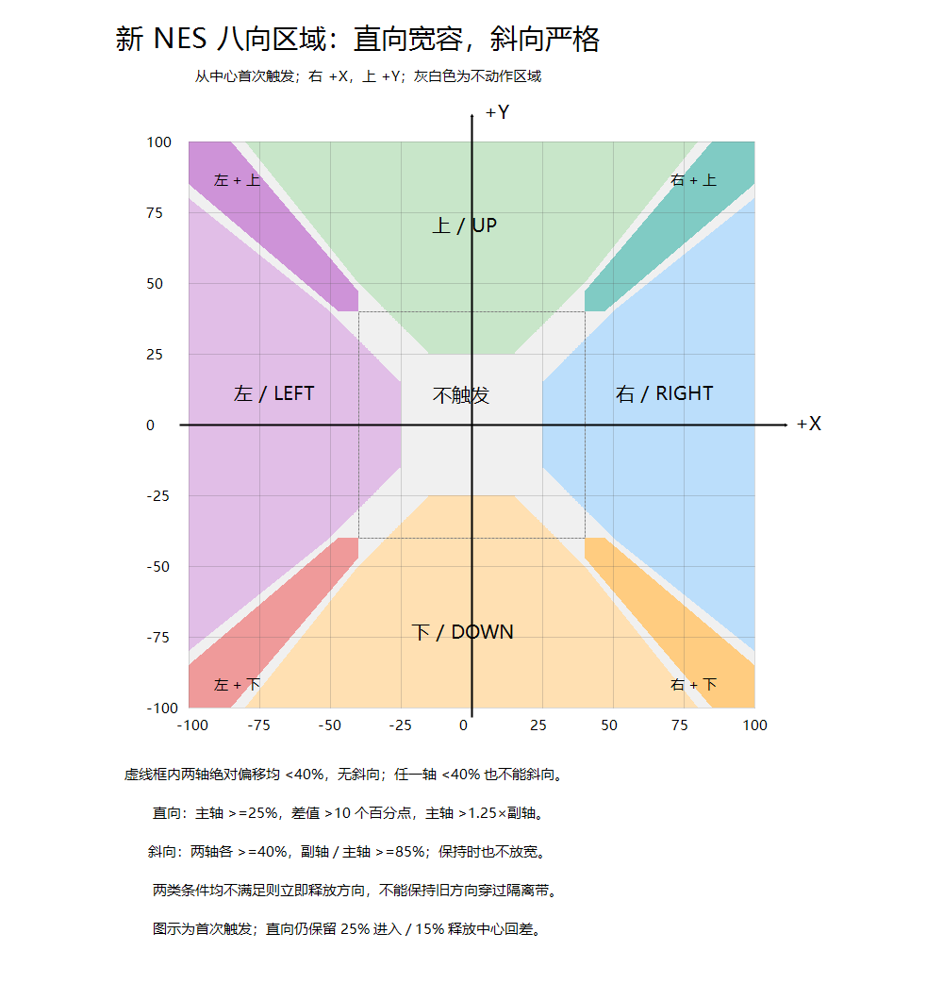

# Minibox ESP32-S3 N16R8

默认运行从 Talking Alarm 迁移的完整应用：闲聊闹钟（豆包 ASR → Agent → TTS、
聊天记录、手动闲聊、整点播报、安静模式）、24 个网络电台、Wi-Fi 扫描与密码输入、
API 设置门户、SNTP 校时、俄罗斯方块、贪吃蛇和 NES 模拟器。界面使用 **LVGL 8.4**，
输出到原有 **ST7796 480×320**；硬件接线、屏幕驱动、PCF8563、
INMP441/MAX98357、Flash/PSRAM 配置不变，不依赖参考目录。
参考版本随机闲聊次数为 0，迁移后同样默认关闭，保留调度逻辑。

## 启动画面与字库

默认启动显示 DOS 风格黑底控制台，左上角为用户提供的高清经典 Energy Star 位图，
逐项显示实际初始化状态、耗时和字体读取进度，不依赖中文字库绘制启动文字。
本地就绪即进入主界面；Wi-Fi 连接、SNTP 校时及 Wi-Fi 扫描在后台运行，
不因网络等待阻塞本地操作。网络任务忙时，网络切换和 API 配置会提示稍后重试。
离线发起语音、电台或手动闲聊时先后台连接，连接完成后再次操作。

中文字库改为 GB2312 的 6,763 个汉字加英文、标点及界面用字，共 7,311 字形，
24 px、2-bit 四级灰度，占 1,123,256 字节（约 1.07 MiB），比旧字库减少约 82.5%。
缺字在默认界面显示问号。分区表不变，未自动将字体分区空闲空间分配给 ROM。
本次部署需更新应用与字体，不能仅 `app-flash` 就获得新的字库；
无需改写保存配置、ROM 和存档的 storage。
详见[显示与字体说明](../docs/display-fonts.md)。

## 默认应用操作

摇杆仅负责上下左右导航，开机约 640 ms 内保持居中；不使用摇杆按压。
导航映射为 Y 轴（GPIO2）控制屏幕左右、X 轴（GPIO1）控制屏幕上下；
X 轴在导航映射时额外取反，使物理向下对应屏幕向下，Y 轴保持不变。
接线及各物理轴的反转设置不变，硬件诊断仍显示原始 X/Y 轴。
菜单采用四方向双门槛隔离，NES 恢复八方向并提高斜向中心门槛。
将两轴归一化偏移的绝对值中较大者记为 M、较小者记为 m：
菜单必须同时满足 M-m >15 个百分点、M >1.5m，才允许输出主轴方向。
NES 直向更易触发：M-m >10 个百分点、M >1.25m。
边界等于门槛也不触发；副轴为零时仍按乘法比较，避免除零。
首次进入方向还需主轴偏移至少 25%，保持同方向需超过 15%。
NES 斜向更严格：两轴绝对偏移都至少 40%，副轴/主轴至少 85% 才输出。
进入和保持都要求这些条件，不沿用旧版 45% 比例保持规则；任一轴低于
40% 就退出斜向，不能利用保持回差在中心附近继续输出双方向。
因此大幅推杆时，副轴/主轴在 80%～85%（包含 80%、不含 85%）是隔离带。
不满足斜向条件时回到单方向双门槛判定；两类条件都不满足则立即清除方向，
不保持旧方向。斜向等效于两个相邻方向键同时按住；菜单始终不输出斜向。
门槛集中在 `main/joystick_logic.h`，不增加滤波或延迟；菜单重复仍为
首次 350 ms、随后每 140 ms，NES 每次模拟帧读取当前方向状态。
原始硬件诊断仍显示独立轴读数。这些默认值不能代替实物方向与回中检查。
UI 按键按实物布局命名：第一行 A、B，第二行 X、Y，
分别对应 GPIO4、GPIO5、GPIO6、GPIO7，接线不变。
A 短按确认，在闲聊中长按录音、松开发送；B 在闲聊中按住即可录音，
松开发送，最长 10 秒。X 返回/主页，Y 辅助确认（闲聊动作卡可请求闲聊）。
音频使用 Core 1，网络和应用使用 Core 0。录音和播放严格半双工，
64 KiB 软件音频环形缓冲放在 PSRAM，保留内部 RAM 给 I2S DMA，
避免电台解码与 HTTPS 同时运行时出现 DMA 分配失败。
启动画面的 15 KiB 临时像素缓冲也放 PSRAM，交给 LVGL 后释放；
电台的 2 KiB 输入和 8 KiB PCM 解码缓冲显式放 PSRAM。
普通播放仍使用 8×512 帧（16 KiB）的内部 I2S DMA，不削减语音或游戏配置。
电台日志在 HTTPS、解码、I2S 启动及清理阶段记录内部/DMA 可用量与最大连续块；
I2S 初始化失败直接返回实际错误，界面区分内存不足与超时。
释放当前 I2S0 通道后才切换方向，共用 GPIO39/40；GPIO47 仅播放时拉高，
GPIO42 保留默认高阻。原始录放音回声测试仍可通过诊断模式使用。

### NES 摇杆活跃区域：旧版与新版

两图均表示**从中心、上一方向为空时的首次触发**，横轴向右为正、
纵轴向上为正，数值为映射后的归一化偏移百分比，不是 GPIO 轴名。
灰白区域不输出方向；斜向等效于两个相邻方向键同时按住。
直向保持时仍有 25% 进入、15% 释放中心回差，不能只靠首触发图描述全部历史状态。

**旧版：**两轴各至少 25%，副轴/主轴至少 65% 即进入斜向；
同一斜向可保持到比例 45%，每轴同向偏移大于 15%。方向之间没有隔离带。
下图仅保留作历史对照，不是当前规则。



**新版：直向更容易，斜向更严格。**

| 输出 | 首次触发条件 |
|---|---|
| 上下左右 | 主轴至少 25%，差值 >10 个百分点，主轴 >1.25 倍副轴 |
| 四个斜向 | 两轴各至少 40%，副轴/主轴 >=85%，保持时不放宽 |
| 隔离区 | 单向和斜向条件均不满足，立即清除方向，不保持旧方向 |

例如水平偏移 100%：垂直偏移 79% 时仍只输出水平；80%～84% 不动作；
达到 85% 才输出斜向。两轴各 30% 不触发斜向。
菜单仍用独立四向规则（差值 >15 个百分点、主轴 >1.5 倍副轴），不应用 NES 的斜向条件。



本版已完成方向边界与历史状态回归、ESP-IDF 构建，并在 COM8 执行
`app-flash`，写入校验通过并自动复位。仅更新应用，ROM、配置、存档和字体分区未改写。
这不等同于实际操作手感和所有游戏兼容性已验收。

## 本地文件配置分区

私密配置只放在 Git 忽略的 `config_data` 中，**不写入 C 头文件或默认配置**：

| 文件 | 格式 |
|---|---|
| `config_data\wifi_config.txt` | 第 1 行 SSID，第 2 行 Wi-Fi 密码，末尾换行 |
| `config_data\app_secrets.txt` | ASR、Agent、TTS API key 各一行，按此顺序，末尾换行 |

从全新检出构建时，先自行创建这些文件；留空也可构建，启动后在设备设置中配置
Wi-Fi，并进入 API 设置模式，连接 `Minibox-Setup`（接入密码 `minibox-setup`），
浏览 `http://192.168.4.1/`。此门户仅手动启用，完成后在设备上退出。
API URL、资源 ID、Bot ID 和音色在 `main\app_config.h` 中固定；
ASR WebSocket 的固定主机和路径在 `doubao_asr_client.c`。
HTTPS/WSS 使用证书包校验，不沿用参考工程的跳过证书验证设置。
没有迁移参考工程的具体位置资料。

配置使用独立 `storage` SPIFFS 分区（0xC10000，0x3F0000 字节），挂载到
`/spiffs`；原 `fonts` 分区及应用分区地址不变。构建自动生成
`build\storage.bin`；用户明确要求后执行 `idf.py -p COM8 flash` 才写入设备。
**完整 flash 会覆盖设备上已保存的 Wi-Fi/API 配置，恢复为本地配置文件的内容**。
仅更新应用、不覆盖配置时使用 `idf.py -p COM8 app-flash`（仍需明确授权烧录）。
配置和镜像包含明文凭据；不要提交或分享 `config_data` 私密文件、`storage.bin`
或包含配置的整包固件。普通 `idf.py build` 不会访问豆包服务或消费 API 配额。

## NES 游戏

本项目用于用户自己的个人娱乐，不以商业发布或销售为目标。
开发时不默认开展商业发布合规审查，不反复询问商业授权；保留第三方源码
原有许可证与来源记录。ROM 只按用户明确指定的文件或链接处理，不自行寻找
或替换其他游戏；测试状态以实际执行结果为准。

首页第六个应用为 **NES**。基于 `esp32-nesemu` 的 Nofrendo CPU/PPU/APU
内核移植，独立构建，不依赖参考目录；同时参考 `Anemoia-ESP32` 的
40 MHz SPI 隔帧输出、持续手柄状态及 ROM 校验值隔离存档的设计，
不导入其 Arduino/TFT_eSPI 驱动或 GPLv3 源码。来源、版本、修改与许可证见
[`components/nofrendo/README.md`](components/nofrendo/README.md)。
三个参考项目的逐项取舍、详细阶段计划与验收状态见
[`NES 实现与验收计划`](../docs/nes-implementation-plan.md)。

当前载板没有 SD 卡，游戏使用已有 `storage` SPIFFS 分区：

1. 自行将有权使用的 **NTSC iNES 1.0 `.nes`** 文件放到
   `esp32_idf_s3n16r8\config_data` 根目录，例如 `demo.nes`。
   当前用户指定的 10 个 ROM 已纳入 Git，异地检出后无需再次手动复制。
   文件名建议使用 ASCII，包含扩展名最多 **24 字节**；列表最多显示 32 个。
2. 在 ESP-IDF 5.3.5 环境执行 `idf.py build`，游戏与本地配置一起打包到
   `build\storage.bin`。单个 ROM 最多 2 MiB；分区约 3.94 MiB，SPIFFS
   需要额外空间，建议所有 ROM 合计不超过 **2.5 MiB**，为配置及存档留余量。
3. **明确授权写入设备后**，首次更新应用与游戏可执行
   `idf.py -p COM8 flash`；仅替换游戏数据可执行
   `$env:ESPPORT='COM8'; $env:ESPBAUD='460800'; idf.py storage-flash`。
   分区自定义 target 不一定传递 `idf.py -p` 参数，须显式设置 `ESPPORT`，
   避免自动扫描其他设备。两者都会覆盖设备上原有 storage 内容，
   包括 Wi-Fi/API 配置和 NES 存档；执行前自行保留所需配置及存档。
   `app-flash` 不更新 ROM、配置或存档。不要分享包含凭据的 storage 镜像。
4. 首页进入 NES，摇杆上下选择，A 加载，Y 重新扫描，X 返回。
   错误格式、截断文件、不支持的 mapper、内存不足及存档失败会显示错误并记录日志。
   已知游戏按英文文件名匹配中英文标题，每项分两行显示、每页三项；
   未配置标题的其他 ROM 仍显示文件名，加载路径和存档身份不受标题影响。

| 游戏内控制 | 现有硬件 |
|---|---|
| A / B | 第一行 A=GPIO4 / B=GPIO5，支持持续按住及组合 |
| Select / Start | 第二行 X=GPIO6 / Y=GPIO7 |
| 方向与斜向 | 复用 GPIO1/2；斜向每轴至少 40% 且满足比例门槛，隔离区不输出方向 |
| 退出到 ROM 列表 | 同时按住 X+Y 至少 1 秒，松开后恢复菜单操作 |

支持 mapper **0、1、2、3、4、7、66、112、178、245**，新增 NTDEC/ASDER、
Waixing 及 Waixing MMC3；不承诺该旧内核兼容所有游戏/mapper 变体。
仅 NTSC、单人控制器；不支持 NES 2.0、PAL、FDS、VS、压缩包、即时存读档
或额外扩展音源。带电池标志的卡带使用 8 KiB SRAM，mapper 178 使用
可切换的 32 KiB RAM 并完整保存四个 bank；正常退出时写
`nes_<ROM CRC32>.sav`，下次加载恢复；CRC32 包含头部、trainer、PRG 与 CHR，
更换同名 ROM 不会自动沿用原存档，重命名相同 ROM 则仍可识别。
`.sav.bak` 是替换前的备份，主文件不存在时自动读取。
断电或直接复位不会保存本次进度。损坏的存档会明确报错而不是静默覆盖。

这里模拟的是**卡带电池存档**，不是任意时刻保存 CPU/PPU/音频状态的
即时存档：先在游戏内执行其原有保存操作，再长按 X+Y 退出至列表，
等待退出完成后才关机。游戏运行期间的 SRAM 写入只在模拟 RAM 中，
退出时才持久化到 `/spiffs/nes_<ROM CRC32>.sav`，下次打开自动恢复。
不带电池标志的 ROM 不生成此文件，密码续关仍按游戏原有规则。
当前 ROM 头检查显示 `uncharted_waters7.nes`（mapper 178）和
`zelda_cn.nes`（mapper 245）带电池标志；这不等于已实机验证游戏内存档。
完整 `flash` 或 `storage-flash` 会替换存档所在分区，更新前需备份。

按用户要求恢复 **256×240 原生像素、不缩放、不拉伸、不裁剪**，
在 ST7796 480×320 上居中显示：左右各 112 像素、上下各 40 像素黑边。
一个 NES 像素对应一个屏幕像素，不再做电视 4:3 比例校正。
保留单一 LVGL 显示驱动。
目标为 60 次/秒模拟、每两帧尝试提交一次画面（最高 30 fps）。
模拟器只复制 256×240 索引帧及调色板；Core 0 显示任务转换颜色，
按 16 行条带比较 RGB565，只刷新变化范围，静止画面不重复传输。
两个索引缓冲中一个供显示任务读取、另一个接收下一帧；交换后立即释放
独立邮箱锁，颜色转换和 SPI 均不占用该锁，也不阻塞 Core 1 的 CPU/APU。
下一帧仍在等待显示时不再做无用的 PPU 绘图。
完整一帧为 122,880 字节，比 426×320 减少约 55%；
30 fps 全帧刷新约 3.69 MB/s，低于 40 MHz SPI 的理论 5 MB/s，
但仍有协议、调度和模拟开销，不能仅凭带宽保证所有游戏无卡顿。
ROM、索引缓冲和 LVGL 视频图像都放 PSRAM，
邮箱额外占用 120 KiB。实际速度仍需实板确认。
24 kHz/16-bit 单声道音频幅度减半，
经现有 `audio_io` 转双声道输出到 MAX98357，GPIO39/40/41/42/47 不变。
APU 在寄存器读写前及扫描线末按 CPU 周期推进，避免整帧结束后才生成
PCM 而丢失帧内启停。I2S 消费进度通过软件缓冲水位控制模拟，不叠加独立
60 Hz 睡眠；启动预填四帧，运行水位为三帧（约 50 ms 软件缓冲），
低于两帧时跳过 PPU 绘图优先补充 PCM，CPU/APU 和手柄采样仍继续。
不使用整个 64 KiB ring 堆积游戏音频。五秒日志增加音频优先跳帧次数、
最大模拟帧耗时和最大提交耗时，区分 CPU 压力与显示提交阻塞；
`audio_underrun` 仍是音频任务的软件饥饿计数，不能单独证明实际听感正常。
NES 专用 DMA 为 3×256 帧，按完整 256 样本块供给；每帧 400 样本的余数
保留到下一块，避免部分 DMA 块在后续 PCM 到达前被回收。仅退出时排空尾块。
电台/TTS 仍使用原 DMA 配置，不更换驱动或增加并发 APU 任务。
电台或语音忙时拒绝启动 NES；游戏运行和退出清理期间暂停自动播报、
自动联网重试及校时，退出后恢复正常应用调度。麦克风不与游戏音频并行。

### ROM 来源记录

用户另行指定 Downloads 中的七份本地 ROM，复制到 `config_data` 后保留
下载目录原件，内容 SHA-256 一致，不修改文件头，不从网络下载替代文件。
随后按用户要求用 Downloads 中的 `吃豆.nes` 替换口袋妖怪，
英文文件名为 `pacman.nes`，保留下载原件、复制哈希一致。
当前共 10 个 ROM、1,892,512 字节（约 1.80 MiB），其余九份内容不变。

| 中文显示名 | 英文显示名 | 英文文件名 | Mapper |
|---|---|---|---:|
| 冒险岛1 | Adventure Island | `adventure_island.nes` | 3 |
| 坦克大战 | Battle City | `battle_city.nes` | 0 |
| 桌球 | Billiards | `billiards.nes` | 4 |
| 魂斗罗 | Contra | `contra.nes` | 2 |
| 拳皇97 | King of Fighters 97 | `kof97.nes` | 4 |
| 吃豆 | Pac-Man | `pacman.nes` | 0 |
| 超级玛丽 | Super Mario | `super_mario.nes` | 0 |
| 三国志-群雄争霸 | Three Kingdoms | `three_kingdoms.nes` | 112 |
| 大航海7 | Uncharted Waters 7 | `uncharted_waters7.nes` | 178 |
| 塞尔达传说汉化版 | The Legend of Zelda | `zelda_cn.nes` | 245 |

英文标题为列表标签，不是对这些改版 ROM 官方英文名称的认定。
新增文件与替换用吃豆均通过 iNES 头部与长度检查。当前 10 个 ROM 及中英文
列表已在 COM8 完成 `app-flash` 和 `storage-flash`，写入校验通过。
初次导入前的完整备份为 `build\storage-before-rom-import.bin`，
替换吃豆前的完整备份为 `build\storage-before-pacman.bin`；
均在本地 Git 忽略目录，含私密配置，不可分享。
设备 storage 已替换为本地文件内容，备份并未自动合并回新分区。
最初写入时 mapper 112、178、245 尚不支持；随后补齐其银行切换，
参考版本与适配边界见内核 README。不能把 mapper 回归或烧录成功视为
这些改版游戏的完整运行、声音与操作验收。

仅记录用户指定的以下来源，不自行寻找或替换 ROM：

| 原文件 | 本地英文名 | 用户提供的地址 |
|---|---|---|
| 超级玛丽.nes | `super_mario.nes` | [mengfei523060/nesrom](https://github.com/mengfei523060/nesrom/blob/master/%E8%B6%85%E7%BA%A7%E7%8E%9B%E4%B8%BD.nes) |
| 桌球.nes | `billiards.nes` | [mengfei523060/nesrom](https://github.com/mengfei523060/nesrom/blob/master/%E6%A1%8C%E7%90%83.nes) |
| 坦克大战.nes | `battle_city.nes` | [mengfei523060/nesrom](https://github.com/mengfei523060/nesrom/blob/master/%E5%9D%A6%E5%85%8B%E5%A4%A7%E6%88%98.nes) |

实际使用的是用户随后提供的三份本地文件，已按上述英文名移入
`config_data`，未从网络重新下载；移动前后 SHA-256 一致。

| 本地文件 | 字节数 | Mapper | SHA-256 |
|---|---:|---:|---|
| `billiards.nes` | 163856 | 4 | `327c2304647f4604d36d1bf1bbc763b15bb43f2772bfdbed72596cf83572e77c` |
| `battle_city.nes` | 24592 | 0 | `a869aead5b6957fc62002ff9636e048cc34baf0100d629b07dc51aa18f220c0c` |
| `super_mario.nes` | 40976 | 0 | `fac86ec81aa86bd3f637b674569266966992b845f3df22bf7aad18eb9381f671` |

早期三份文件分别完成一次 300 模拟帧的主机加载检查，无 CPU jam，均有画面变化。
桌球和超级玛丽产生非零 PCM；坦克大战在这个短片段中 PCM 为零，尚不能
判断实际游戏内音频是否正常。该检查不是完整游戏兼容性或实板声画验收。

### 当前交付与验收边界

当前已写入设备的应用包含 112/178/245 mapper、原生 256×240 显示、
中英文标题以及直向宽容/斜向严格的摇杆规则。
最新应用大小 **2,011,232 字节**，2 MiB 分区剩余 **85,920 字节**（约 4%）。
最后一次仅执行 COM8 `app-flash`，校验通过并自动复位，保留现有 10 个 ROM。
核心银行切换/存档回归及摇杆边界/历史状态回归通过；
mapper/原生画面版本曾观察到 `boot done`，最新摇杆版未重复现场游戏测试。
实际游戏画面、声音、手感及零卡顿尚未验收。
先前的 426×320 放大方案已被替换，历史过程见
[实现与验收计划](../docs/nes-implementation-plan.md#历史实现与验证记录)。
按用户要求，当前列表中的 10 个 ROM 纳入 Git 用于异地 reload 和复现，
`.gitignore` 仅逐个放行这些英文文件名，不放行整个 `config_data`。
ROM 文件保持用户提供的原始内容；模拟器源码许可证不授予游戏 ROM 的再分发权。
私密配置、密码、API token、存档、固件镜像和设备备份仍不纳入 Git。

异地复现：检出仓库后按“本地文件配置分区”创建自己的
`wifi_config.txt` 和 `app_secrets.txt`（不需要联网功能时可留空），
在 ESP-IDF 5.3.5 环境执行 `idf.py build`。首次安装需完整烧录以写入字体和 ROM；
已有设备只更新 ROM 时先备份配置/存档，再执行 `storage-flash`。
仅 `app-flash` 不会把新检出的 ROM 写入设备。

## 可选原始硬件诊断

在 `idf.py menuconfig` → `Minibox` 启用
`Boot the original hardware diagnostics instead of the LVGL apps`。
以下测试说明仅适用于该模式；默认应用不会执行开机录放音或显示测试色条。

当前固件配套 2026-10-09 载板改版，测试按钮、摇杆、麦克风、扬声器、
PCF8563 RTC 和 ST7796 屏幕。开机显示 RGB/W/K/Y 色条、四键状态、
摇杆 ADC 原始值及百分比、RTC 时分秒和音频状态。旧载板不能直接使用本接线配置。
开机先播放 250 ms 的低幅度 440 Hz 提示音，再录制 1 秒环境声音并回放。
摇杆开机时应保持居中、不要触碰，约 640 ms 完成中心校准；失败会显示错误，
不阻止其他外设测试，松开摇杆后按开发板 RESET 重试。
**按住 GPIO5** 按钮立即开始录音（消抖约 30 ms），最多录制 3 秒；
录满会停止采集并等待松开。**松开 GPIO5** 后从 MAX98357 播放录音。
播放期间的按键不触发新录音，播放完成并松开后可再次测试。GPIO4 和
GPIO6、GPIO7 只显示按键状态，不触发录音。
串口会报告麦克风采样数、幅度和音频错误。默认不连接 Wi-Fi；
可启用下述动感101网络电台模式专门测试喇叭。

## 动感101网络电台测试

在 `idf.py menuconfig` → `Minibox` 的硬件诊断模式中启用
`Speaker test: play Donggan 101 instead of microphone recording`，
并在同一菜单本地设置 Wi-Fi 名称和密码。密码只保存在 Git 忽略的
`sdkconfig` 和构建产物中，不写入源码、默认配置或文档，不分享带凭据的固件。
该选项只影响硬件诊断，不影响默认应用的电台或语音功能。

该模式只播放动感101，固定流地址为
`https://lhttp.qtfm.cn/live/274/64k.mp3`，不切换其他电台。
连接 2.4 GHz Wi-Fi、取得 IP 后通过 `ntp.aliyun.com` 同步系统时间，
再用证书校验的 HTTPS 拉取 MP3、解码成 16-bit PCM 并输出到 MAX98357。
输出数字幅度为原始 PCM 的一半，功放 GAIN 仍默认高阻。
断网会尝试重连，音频流出错后等待 5 秒重试同一电台；
串口报告 HTTP 状态、MP3 格式和累计 I2S 输出量，屏幕显示连接/播放状态。

四键、摇杆、RTC 和屏幕仍继续测试，但开机提示音、环境录音及 GPIO5
录音回放均禁用，避免同时驱动共用的 I2S 时钟线。
关闭电台模式并重新构建烧录后恢复麦克风测试。
若 Wi-Fi 启动时发生欠压复位，检查 USB 线、外部电源和负载，
不能通过关闭欠压检测掩盖供电问题。

## 接线

| 模块 | 信号 | ESP32-S3 |
|---|---|---|
| 四个直焊机械轴 | 两个常开触点 | 分别接 GPIO4/5/6/7 与 GND，不接 VCC |
| INMP441 麦克风 | SD / WS / SCK / L/R | GPIO21 / GPIO39 / GPIO40 / GND |
| MAX98357 放大器 | DIN / LRC / BCLK | GPIO41 / GPIO39 / GPIO40 |
| MAX98357 放大器 | SD/MODE / GAIN | GPIO47 / GPIO42 |
| 摇杆 | X / Y | GPIO1 / GPIO2 |
| 摇杆按压（不使用） | K | 按压焊脚 NC，驱动不配置按压 GPIO；GPIO42 用于功放 GAIN |
| PCF8563 RTC（I2C 地址 0x51） | SDA / SCL | GPIO15 / GPIO16 |
| 未连接 GPIO | GPIO17 | 悬空 NC，不配置 |

INMP441 正面视角左列从上到下为 L/R、WS、SCK，右列为 GND、VCC、SD；
此处描述信号位置，不改变模块物理焊盘编号。

直焊机械轴按下接地，必须使用 GPIO 内部上拉及低有效配置。若改接高有效模块，
先在 `idf.py menuconfig` → `Minibox` 关闭
`GPIO4/5/6/7 buttons pressed at low level`，再构建烧录。不要让按钮
OUT 超过 3.3 V；四路按钮共地。录音和回放共用 GPIO40/39 时钟线，
固件先释放麦克风 I2S 通道再启用放大器。GPIO47 在回放时使能放大器；
GAIN=GPIO42 默认高阻；菜单中的 12 dB 选项将 GPIO42 输出为低电平。
扬声器接 SPK+/SPK-，模块按额定电压供电。
屏幕 GPIO9–14、完整模块参数和注意事项见
[`docs/hardware-connections.md`](../docs/hardware-connections.md)。
GPIO40/41 没有 ADC，不能用于摇杆 X/Y；摇杆配置默认值已改为
GPIO1/2，按压功能关闭。旧本地 `sdkconfig` 必须同步轴配置。编译检查会拒绝
摇杆与键盘或音频引脚冲突的配置。现有实物接线必须与新分配同步，
不能只更新固件而保持原接线。

## 现场测试

- 四键：分别按下和松开，确认第一行 A/B、第二行 X/Y 的 UP/DOWN 状态和串口 GPIO 事件。
- 摇杆：向四个方向推到端点，确认 X/Y 原始值及百分比变化，再松开回中。
  百分比使用启动中心和 ADC 0–4095 范围估算，不是实测端点标定；
  3.3 V 端可能超过 ADC 有效量程而饱和，不能据此测量精确电压。
- 音频：听开机提示音和环境声回放；正常运行后按住 KEY2（GPIO5）说话，
  松开后听回放。串口报告采样数、最小/最大值、非零数和平均绝对幅度；
  软件 I/O 成功不代表实际听到了声音，非零采样也不能单独证明麦克风正常。
- RTC：每秒读取完整日历，确认秒数持续变化后显示 `TICK OK`。
  读失败、无应答、无效日历或超过约 3 秒不走时均明确报告错误。
  只在停振或低电压标志置位时写入本机编译时间并重启计时，正常 RTC 时间不覆盖。
  编译时间有构建/烧录延迟，不是精确校时；掉电保持和走时精度需单独实测。
- 屏幕：确认横屏 480×320、文字、边框及色条正常，R/G/B 颜色不互换；
  初始化日志不能代替肉眼检查。

## 构建与观察

使用 ESP-IDF 5.3.5 PowerShell 环境：

```powershell
Set-Location C:\gitroot\minibox\esp32_idf_s3n16r8
idf.py build
```

明确准备覆盖板上固件时才执行 `idf.py -p COM8 flash`，之后可执行
`idf.py -p COM8 monitor` 查看串口（`Ctrl+]` 退出）。烧录会同时写入
SPIFFS 字体分区；屏幕缺字或初始化失败时核对字体镜像、GPIO9 背光和
供电。电台模式曾在 Wi-Fi 启动时触发欠压复位；默认应用会启动 Wi-Fi，
只有未启用电台测试的硬件诊断不启动 Wi-Fi。
如仍发生 brownout，请先检查 USB 线、供电和外设负载，而非关闭欠压保护。
构建或串口日志不能代替现场检查屏幕、麦克风和扬声器。
